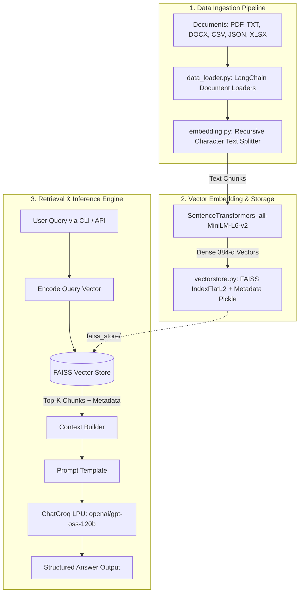

# ⚡ NotesRAG — Production-Grade Modular Retrieval-Augmented Generation

[](https://www.python.org/downloads/)
[](https://www.langchain.com/)
[](https://github.com/facebookresearch/faiss)
[](https://groq.com/)
[](LICENSE)
[](CONTRIBUTING.md)

**NotesRAG** is a modular, high-performance Retrieval-Augmented Generation (RAG) system engineered for enterprise document question-answering and technical search. Powered by **LangChain**, local **FAISS** vector indexing, and ultra-low-latency **Groq LPU** inference, NotesRAG delivers fast, grounded, and context-accurate answers from your documents.

---

## 📑 Table of Contents

- [Architecture & Workflow](#-architecture--workflow)
- [Key Features](#-key-features)
- [Project Structure](#-project-structure)
- [Prerequisites](#-prerequisites)
- [Quick Start](#-quick-start)
- [CLI & Usage Modes](#-cli--usage-modes)
- [Programmatic API](#-programmatic-api)
- [Configuration Reference](#-configuration-reference)
- [Troubleshooting & FAQ](#-troubleshooting--faq)
- [Contributing](#-contributing)
- [License](#-license)

---

## 🏛️ Architecture & Workflow

NotesRAG separates document ingestion, embedding generation, vector indexing, and generation into cleanly decoupled modules:



---

## ✨ Key Features

- **Multi-Format Ingestion**: Native loaders for `.pdf`, `.txt`, `.docx`, `.json`, `.csv`, and `.xlsx` with automatic metadata attribution.
- **Semantic Text Chunking**: Recursive character splitting with customizable chunk size (500 tokens) and overlap (150 tokens) to preserve context continuity.
- **Dense Vector Search**: Powered by Facebook AI Similarity Search (**FAISS**) for sub-millisecond similarity lookups with persistent disk caching.
- **Ultra-Fast LLM Inference**: Direct integration with **Groq LPUs** via `langchain-groq` for high-throughput, low-latency synthesis.
- **Smart Auto-Indexing**: Automatically builds or updates the vector store if absent, eliminating manual setup friction.
- **Interactive CLI & Batch Mode**: Includes interactive chat shell, single-query flags, and one-click index rebuilds.
- **Production Git Hygiene**: Sensitive files, vector binaries, and private data are safely ignored via `.gitignore` and template-configured via `.env.example`.

---

## 📂 Project Structure

```text
notesrag/
├── app.py                     # Production CLI entry point & Interactive Q&A runner
├── pyproject.toml             # Project metadata, dependencies & CLI script definition
├── requirements.txt           # Standard pip requirement specifications
├── uv.lock                    # Deterministic dependency lockfile (UV package manager)
├── .env.example               # Environment variable configuration template
├── .gitignore                 # Production-grade Git exclusions (caches, vector DBs, secrets)
├── README.md                  # Comprehensive system documentation
│
├── src/                       # Core modular package
│   ├── __init__.py            # Package root & component exports
│   ├── data_loader.py         # Multi-format document ingestion engine
│   ├── embedding.py           # Document chunker & SentenceTransformer embedding pipeline
│   ├── vectorstore.py         # Persistent FAISS vector store & similarity search
│   └── search.py              # End-to-end RAG orchestrator with Groq LLM synthesis
│
├── data/                      # Input document repository
│   ├── pdf/                   # Directory for PDF files (.gitkeep enabled)
│   └── text_files/            # Clean sample text documents (ML & Python guides)
│
└── notebook/                  # Interactive experimentation & research
    ├── document.ipynb         # Document schema & manipulation notebook
    └── pdf_loader.ipynb       # Ingestion & chunking benchmarking notebook
```

---

## 🛠️ Prerequisites

- **Python**: `>= 3.13`
- **Groq API Key**: Obtain a free API key at [Groq Console](https://console.groq.com/keys)
- **Package Manager**: [uv](https://docs.astral.sh/uv/) (recommended) or `pip`

---

## 🚀 Quick Start

### 1. Clone the Repository

```bash
git clone https://github.com/sudhakarreddy2005/notesrag.git
cd notesrag
```

### 2. Configure Environment Variables

Create your local `.env` configuration file from the template:

```bash
cp .env.example .env
```

Open `.env` and insert your **Groq API Key**:

```env
GROQ_API_KEY=gsk_your_actual_groq_api_key_here
GROQ_MODEL=openai/gpt-oss-120b
```

### 3. Setup Virtual Environment & Install Dependencies

#### Option A: Using `uv` (Recommended — 10x faster)

```bash
# Create virtual environment
uv venv

# Activate virtual environment
source .venv/bin/activate    # On Linux/macOS
# .venv\Scripts\activate     # On Windows

# Install project dependencies
uv sync
```

#### Option B: Using standard `pip`

```bash
# Create virtual environment
python -m venv .venv

# Activate virtual environment
source .venv/bin/activate    # On Linux/macOS
# .venv\Scripts\activate     # On Windows

# Install requirements
pip install -r requirements.txt
```

### 4. Run Your First Query

```bash
python app.py -q "What is supervised learning?"
```

The system will automatically ingest documents from `data/`, generate dense embeddings, build the FAISS index in `faiss_store/`, retrieve relevant context, and output an accurate answer!

---

## 💻 CLI & Usage Modes

NotesRAG provides a command-line interface with several operational modes:

### Single Query Mode

Ask a specific question directly:

```bash
python app.py -q "Explain the difference between classification and regression"
```

### Interactive Q&A Mode

Start a continuous conversational terminal session:

```bash
python app.py -i
```

```text
============================================================
  NotesRAG Interactive Q&A (Type 'exit' or 'q' to quit)
============================================================

Ask a question: What are the core paradigms of machine learning?
[Thinking...]

--- Answer ---
Machine learning features three core paradigms:
1. Supervised Learning: Learning from labeled data (classification & regression).
2. Unsupervised Learning: Discovering hidden patterns in unlabeled data (clustering & dimensionality reduction).
3. Reinforcement Learning: Agents learning optimal policies through trial-and-error rewards.
------------------------------------------------------------
```

### Custom Context Depth (`--top-k`)

Retrieve a custom number of context chunks:

```bash
python app.py -q "What is deep learning?" -k 5
```

### Force Index Rebuild (`--rebuild`)

When you add new documents to `data/`, force a complete re-index:

```bash
python app.py --rebuild -q "What is Python?"
```

### CLI Arguments Overview

| Flag | Long Flag | Description | Default |
|:---|:---|:---|:---|
| `-q` | `--query` | Query to execute against the knowledge base | Default demo query |
| `-k` | `--top-k` | Number of context chunks to retrieve | `3` |
| `-i` | `--interactive` | Launch interactive terminal Q&A session | `False` |
| `--rebuild` | `--rebuild` | Force rebuild of FAISS index from `data/` | `False` |
| `-h` | `--help` | Show CLI help manual | — |

---

## 🧩 Programmatic API

You can also import and integrate NotesRAG modules directly into your own Python applications or web APIs:

```python
from src.data_loader import load_all_documents
from src.vectorstore import FaissVectorStore
from src.search import RAGSearch

# 1. Load documents from any directory
docs = load_all_documents("data")

# 2. Build or load FAISS Vector Store
store = FaissVectorStore(persist_dir="faiss_store")
store.build_from_documents(docs)

# 3. Perform semantic similarity search
results = store.query("Explain supervised learning", top_k=3)
for r in results:
    print(f"Distance: {r['distance']:.4f} | Source: {r['metadata'].get('source_name')}")

# 4. Generate grounded answers with Groq LLM
rag = RAGSearch(persist_dir="faiss_store", llm_model="openai/gpt-oss-120b")
answer = rag.search_and_summarize("What is unsupervised learning?", top_k=3)
print(answer)
```

---

## ⚙️ Configuration Reference

All settings can be configured via environment variables or in your `.env` file:

| Environment Variable | Description | Default | Options / Notes |
|:---|:---|:---|:---|
| `GROQ_API_KEY` | API key for Groq inference service | *Required* | Obtain from [console.groq.com](https://console.groq.com/keys) |
| `GROQ_MODEL` | Large Language Model used on Groq | `openai/gpt-oss-120b` | `openai/gpt-oss-120b`, `openai/gpt-oss-20b`, `qwen/qwen3.8-27b` |
| `EMBEDDING_MODEL` | Hugging Face SentenceTransformer model | `all-MiniLM-L6-v2` | Dense embedding model (384 dimensions) |
| `HF_TOKEN` | Hugging Face Hub token (optional) | *None* | Prevents unauthenticated rate limits during initial model download |

---

## ❓ Troubleshooting & FAQ

<details>
<summary><b>1. Error: <code>Missing GROQ_API_KEY</code></b></summary>
Make sure you have copied <code>.env.example</code> to <code>.env</code> and filled in a valid API key:
<pre><code>cp .env.example .env
# Edit .env and set GROQ_API_KEY=gsk_...</code></pre>
</details>

<details>
<summary><b>2. Error: <code>The model ... does not exist or you do not have access to it</code></b></summary>
Verify available models for your Groq tier. NotesRAG defaults to <code>openai/gpt-oss-120b</code>. You can change this in <code>.env</code> by setting:
<pre><code>GROQ_MODEL=openai/gpt-oss-120b</code></pre>
</details>

<details>
<summary><b>3. FAISS index not updating after adding new documents</b></summary>
By default, NotesRAG reuses the existing index saved in <code>faiss_store/</code>. When adding new files to <code>data/</code>, pass the <code>--rebuild</code> flag:
<pre><code>python app.py --rebuild -q "Your question"</code></pre>
</details>

<details>
<summary><b>4. Warning: <code>Sending unauthenticated requests to the HF Hub</code></b></summary>
This warning is harmless. Hugging Face downloads the embedding weights locally on the first run. You can optionally silence it by adding <code>HF_TOKEN=your_token</code> to <code>.env</code>.
</details>

---

## 🤝 Contributing

Contributions, issues, and feature requests are welcome!
1. Fork the Project
2. Create your Feature Branch (`git checkout -b feature/AmazingFeature`)
3. Commit your Changes (`git commit -m 'feat: add amazing feature'`)
4. Push to the Branch (`git push origin feature/AmazingFeature`)
5. Open a Pull Request

---

## 📜 License

Distributed under the **MIT License**. See [`LICENSE`](LICENSE) for more information.

---

<p align="center">
<a href="https://github.com/sudhakarreddy2005">Sudhakar Reddy Konda</a>
</p>
